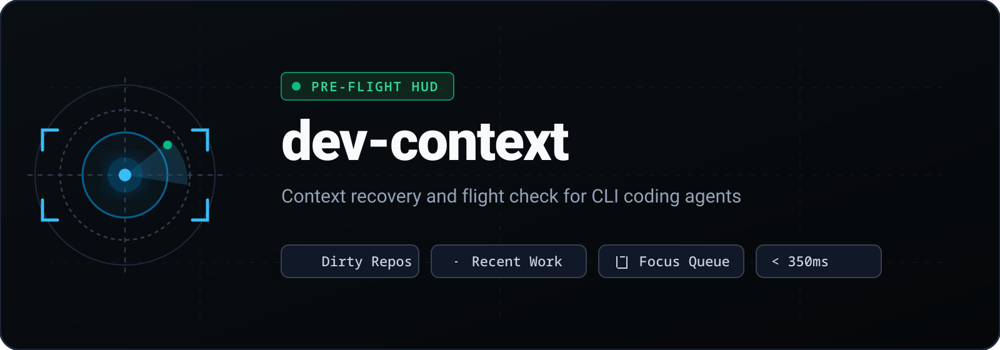

<div align="center">
  <a href="https://github.com/whysooraj/dev-context">
    
  </a>
</div>

<div align="center">
  <p><strong>A local-first context layer that helps coding agents resume development across projects and sessions.</strong></p>
  <p>Sub-second pre-flight context dashboard, native agent injection, and session handoff engine for Antigravity, Claude Code, Cursor, and Codex.</p>

[](https://m8ven.ai/mcp/whysooraj-dev-context-ka69y4?s=readme)

</div>

---

## One-Line Install

Run the interactive multi-step installer:

```bash
curl -fsSL https://raw.githubusercontent.com/whysooraj/dev-context/main/install.sh | bash
```

The installer detects your local environment and configures 5 integration steps:

1. **Coding Agent Hooks**: Wraps detected agents (`agy`, `claude`, `codex`) or custom CLI commands.
2. **Shell Environment**: Writes clean, non-destructive hooks for Fish (`conf.d/dev_context_wrappers.fish`), Bash (`~/.bashrc`), or Zsh (`~/.zshrc`).
3. **Binary Location**: Installs standalone `dev-context`, `dev_context_mcp.py`, and short `dc` alias to `~/.local/bin/`.
4. **Focus Queue**: Scaffolds a starter `ROADMAP.md` in your projects directory.
5. **Native Agent Setup**: Configures Model Context Protocol (MCP) server for Claude Code and Cursor.

---

## The Problem: The Agent Cold-Start Penalty

When switching between projects or resuming an interrupted session, coding agents start blind:

```text
> What would you like to work on?
_
```

Without persistent context handoff:
- Agent A gets interrupted or hits context limits midway through a refactor.
- Agent B (or the developer hours later) arrives at an empty prompt with zero memory of the exact next step.
- Minutes are wasted running `git status`, inspecting diffs, checking recent commits, and asking redundant questions.
- Uncommitted work across other repositories in the workspace remains invisible until conflicts arise.

---

## The Solution: Seamless Agent Handoff (`dc resume`)

`dev-context` turns session resumption into an instantaneous, deterministic operation.

### Before and After Workflow

```
[Agent A / Previous Session]
  1. Implements Redis connection pool in my-api-service.
  2. Runs:
     dc goal "Add Redis caching layer" \
       --status in_progress \
       --last-step "Implemented connection pooling and failover" \
       --blocker "Serialization test failing on binary payloads" \
       --next "Run cargo test cache::test_binary_payload and fix serde trait"
  3. Context window closes or developer shuts laptop.

[Agent B / Next Session]
  1. Launches terminal or queries MCP server.
  2. Runs `dc resume` (or MCP calls `get_resume_handoff`).
  3. Receives instant operational handoff card with exact next action and diff footprint.
  4. Resumes work immediately without redundant discovery queries.
```

### Resume Output Card (`dc resume`)

```markdown
# Session Handoff: my-api-service (main)
**Repository**: `/home/user/Projects/my-api-service`

## Objective & Status
- **Goal**: Add Redis caching layer
- **Status**: `in_progress`

## What Changed
- **Footprint**: +45 -12 across 3 files
- **Files**:
  - `src/cache/redis.rs`
  - `src/middleware/rate_limit.rs`
  - `tests/cache_test.rs`

## Last Completed Step
Implemented connection pooling and failover logic.

## Blockers & Unfinished Work
- Serialization test failing on binary cache payloads

## Exact Next Concrete Action
> Run `cargo test cache::test_binary_payload` and fix serde trait implementation
```

---

## Pre-Flight Flight Check Layout (`dc`)

Whenever you open a terminal or launch an agent, `dev-context` renders a high-density, sub-100ms status dashboard:

```text
--- DEV FLIGHT CONTEXT ---
[*] my-api-service (main) [CLEAN]
    Last commit (20m ago): feat: add rate limiting middleware
    Active Goal: Add Redis caching layer (in_progress)

[!] In-Progress / Uncommitted Work:
    * web-frontend (3 files modified, +42 -12) - 45m ago: fix: navigation layout
    * auth-service (2 files modified, +18 -4)  - 3h ago: test: add token verification

[+] Recent Activity:
    * worker-pipeline        2 hours ago     -> chore: bump dependencies
    * docs-site              Yesterday       -> docs: update deployment guide

[=] Focus Queue (ROADMAP.md):
    ## Active Sprint
    [1] [a101] [IN-PROGRESS] (my-api-service) add redis cache layer
    [2] [a102] [TODO] (web-frontend) responsive mobile navbar
    ## Ideas Backlog
    [3] [a103] [TODO] (auth-service) webauthn passkey support
--------------------------
```

---

## Model Context Protocol (MCP) Server

`dev-context` provides a built-in, zero-dependency JSON-RPC 2.0 stdio MCP server exposing 8 granular tools designed specifically for autonomous agent workflows.

### Register with Claude Code

```bash
claude mcp add dev-context -- dc mcp
```

Or run automated setup:

```bash
dc setup-agent claude --global
```

### The 8 Primary MCP Tools

| Tool | Parameters | Description |
| :--- | :--- | :--- |
| `get_project_context` | `project` (opt string) | Returns repository metadata, active branch, dirty state, last commit, and recent session history. |
| `get_current_goal` | `project` (opt string) | Returns active objective, lifecycle status, blocker notes, last step completed, and concrete next action. |
| `update_session` | `project`, `objective`, `status`, `last_step`, `next_action`, `blocker`, `decision`, `file_changed` | Atomically updates the local session memory with POSIX lock safeguards. |
| `get_open_tasks` | `project` (opt string), `include_blocked` (bool) | Parses and returns active sprint tasks with stable 4-hex IDs and current state flags. |
| `get_recent_changes` | `project` (opt string), `limit_commits` (int) | Calculates working tree footprint (+ins, -del), touched files list, and recent git commit log. |
| `mark_task_status` | `id` (string), `status` (`start`, `done`, `block`, `rm`), `reason` (opt string) | Updates task state or removes task by stable hex ID. Automatically records blocker reason into session. |
| `get_next_action` | `project` (opt string) | Resolves the immediate next concrete step by combining session directives and top open tasks. |
| `get_resume_handoff` | `project` (opt string), `format` (`markdown` or `json`) | Generates structured handoff document enabling an agent to resume development instantly. |

### Legacy Tool Aliases (Backward Compatibility)

The server also maintains 4 legacy aliases for backward compatibility with earlier integrations:
- `get_active_context` -> alias to `get_project_context`
- `list_tasks` -> alias to `get_open_tasks`
- `set_goal` -> alias to `update_session(objective=...)`
- `update_task` -> alias to `mark_task_status`

---

## Stress Benchmarks & Reproducibility Metrics

`dev-context` is built around a pure Python standard-library engine with parallel worktree inspection, cross-platform advisory file locking, and thread-pool execution.

### Environment & Reproducibility Specifications

| Specification | Measured Configuration |
| :--- | :--- |
| **CPU Model** | 12th Gen Intel(R) Core(TM) i5-12450H (12 logical cores) |
| **Total RAM** | 15.3 GB |
| **OS / Kernel** | Linux 6.18.63-3-lts (x86_64) |
| **Python** | 3.14.3 |
| **Filesystem** | btrfs |
| **Generation Method** | Synthetic Git trees with 15% worktrees, nested depths 1-3, and 10% heavy dirty sets (50+ modified/untracked files) |
| **Cold Isolation** | Each Cold run executes against a newly instantiated, unprimed directory tree |

### 1. Cold Discovery Latency (Fresh Uncached Directory Trees)

Cold measurements test unprimed filesystem traversal and discovery across distinct isolated workspaces:

| Repositories | Discovered | Min | Mean | P50 | Max | Runs |
| :--- | :--- | :--- | :--- | :--- | :--- | :--- |
| **10 repos** | 10 | 8.85 ms | 9.00 ms | 8.96 ms | 9.18 ms | 3 |
| **100 repos** | 100 | 69.22 ms | 70.42 ms | 70.93 ms | 71.11 ms | 3 |
| **500 repos** | 500 | 355.88 ms | 378.69 ms | 377.47 ms | 402.73 ms | 3 |
| **1,000 repos** | 1,000 | 721.96 ms | 737.19 ms | 743.99 ms | 745.63 ms | 3 |

### 2. Warm Discovery Latency (Repeated Scans over Primed Tree)

Warm measurements test repeated agent invocations over an active workspace:

| Repositories | Discovered | Min | Mean | P50 | P95 | P99 | Max | Runs |
| :--- | :--- | :--- | :--- | :--- | :--- | :--- | :--- | :--- |
| **10 repos** | 10 | 7.37 ms | 8.54 ms | 8.60 ms | 9.26 ms | 9.87 ms | 10.02 ms | 20 |
| **100 repos** | 100 | 73.92 ms | 77.33 ms | 76.48 ms | 83.46 ms | 92.64 ms | 94.93 ms | 20 |
| **500 repos** | 500 | 367.19 ms | 379.15 ms | 379.18 ms | 385.82 ms | 386.38 ms | 386.53 ms | 20 |
| **1,000 repos** | 1,000 | 736.90 ms | 789.42 ms | 765.06 ms | 909.17 ms | 929.69 ms | 934.82 ms | 20 |

Performance Nuance:
- Workspaces up to 100 repositories complete discovery and status polling in ~75ms.
- Large workspaces with 500 to 1,000 repositories complete in ~370ms to ~780ms.

### 3. Subprocess Timeout Resilience

```text
===========================================================================
Git Subprocess Timeout & Resilience Safeguard Results
===========================================================================
Total Repositories Tested : 50
Hanging Repositories (Mock): 5 (10%)
Resiliently Discovered     : 45 / 45
Total Elapsed Wall Time    : 0.04s
Resilience Status          : PASSED (Zero Crashes, Unresponsive Tasks Dropped)
===========================================================================
```

Run benchmarks locally:

```bash
python3 benchmarks/benchmark.py --scales 10 100 500 1000 --cold-runs 3 --iterations 20
```

---

## Independent Understanding: The Cross-Agent Handoff Test

Beyond metadata transfer, `dev-context` is verified against autonomous agent reasoning without human clarification (`tests/test_blind_agent_handoff.py`):

1. **Agent A (Claude Code)** starts a task, introduces partial code with an incomplete function (`raise NotImplementedError`), writes a test case, records high-level intent without spoonfeeding internal files or lines, and terminates abruptly.
2. **Agent B (Codex / Cursor)** initializes in the same repository, calls `get_resume_handoff` and `get_recent_changes`.
3. **Autonomous Inspection**: Agent B inspects modified files, locates the incomplete implementation, writes the cryptographic HMAC-SHA256 verification algorithm, and runs the test suite.
4. **Verification**: Tests pass, the objective is marked completed, and zero human prompts were required to transfer context.

---

## Platform Support & Concurrency

Both session state (`~/.config/dev-context/sessions.json`) and task roadmaps (`ROADMAP.md`) enforce process-level safety:

- **Linux & macOS (Tier 1)**: Full POSIX advisory locking via `fcntl.flock(LOCK_EX | LOCK_NB)` with thread-local reentrancy and exponential retry backoff.
- **Windows (Tier 2)**: Native Windows advisory locking via `msvcrt.locking(LK_NBLCK)`.
- **Atomic Replacement**: Writes all modified state to temporary files (`.tmp.<pid>.<uuid>`) in the same filesystem directory, flushes and fsyncs buffers, and executes `os.replace`.
- **Zero In-Lock Prompts**: User prompts and interactive selectors execute before acquiring locks, preventing deadlocks or stalls.
- **Corrupted State Self-Healing**: Detects malformed JSON structures, automatically creates timestamped recovery backups (`.corrupted.<timestamp>.<id>`), and initializes clean state without crashing.

---

## Session Continuity Commands

Manage session state and objectives directly from your terminal:

```bash
# Record active goal with structured handoff directives
dc goal "Add Redis caching layer" \
  --status in_progress \
  --last-step "Added connection pooling" \
  --blocker "Fix binary payload serialization" \
  --next "cargo test cache::test_binary_payload"

# Display active objective and directives
dc goal

# View comprehensive session summary card
dc session

# Generate resumption briefing (Markdown)
dc resume

# Export resumption briefing as structured JSON
dc resume --json
```

---

## Focus Queue & Stable ID Task Management

Task lists in `ROADMAP.md` use deterministic 4-character hex tags for stable agent manipulation:

```markdown
## Active Sprint
- [ ] (besynx) Setup p2p sync <!-- id:b101 -->
- [-] (laya) Filter downloads <!-- id:b102 -->
- [!] (dev-context) Blocked issue <!-- id:b103 -->
- [x] (dev-context) Initial test suite <!-- id:b104 -->
```

Supported States:
- `[TODO]` (`- [ ]`): Open task
- `[IN-PROGRESS]` (`- [-]` or `- [~]`): Work in progress
- `[BLOCKED]` (`- [!]`): Blocked on dependency
- `[DONE]` (`- [x]`): Completed

### Task CLI

```bash
# Add a sprint priority task with auto-generated ID
dc add "my-api-service: add redis cache layer"

# Add a task scoped to a specific project
dc add -p laya "folder preview before move"

# Add an idea to the backlog
dc idea -p auth-service "webauthn passkey support"

# View open tasks with stable IDs and status badges
dc list

# Filter open tasks for a specific project
dc list -p laya

# Mark task in-progress
dc start b101

# Mark task blocked
dc block b101

# Mark task completed
dc done b101

# Delete task
dc rm b101

# Scope task operations to current repository ROADMAP.md
dc add -l "add dry-run unit test"
dc list -l
dc done -l 1
```

---

## Native Agent Injection (`dc export`)

Pipe structured pre-flight context directly into AI coding agents upon startup:

```bash
# Pipe context briefing into Claude Code
claude -p "$(dc export)"

# Explicit agent prompt format
claude -p "$(dc export --agent)"

# Structured JSON export for agent automation pipelines
dc export --json | jq .
```

Sample JSON Export:

```json
{
  "active_project": {
    "name": "dev-context",
    "path": "/home/user/Projects/dev-context",
    "in_git": true,
    "branch": "main",
    "status": "clean",
    "dirty_count": 0,
    "last_commit": {
      "relative_time": "15 minutes ago",
      "subject": "feat: add native agent export"
    }
  },
  "session_goal": "Implement Phase 3: Stress Benchmarks & Resilience",
  "footprint": {
    "summary": "+85 -10 across 3 files",
    "files": ["bin/dev-context", "README.md", "benchmarks/benchmark.py"]
  },
  "priority_tasks": [
    {
      "id": "a101",
      "state": "open",
      "state_label": "[TODO]",
      "text": "Add local MCP server",
      "project": "dev-context"
    }
  ],
  "workspace_alerts": [
    {
      "name": "besynx",
      "path": "/home/user/Projects/besynx",
      "dirty_count": 2,
      "rel_time": "1 hour ago",
      "subject": "feat: p2p sync"
    }
  ]
}
```

---

## Workspace Discovery Logic

`dev-context` scans your workspace without external database services:

| Scan Target | Detection Method | Output Role |
| :--- | :--- | :--- |
| Current Directory | `git status --porcelain` + `git branch` | Shows dirty files, active branch, and last commit |
| Workspace Repos | Recursive discovery up to depth 3 with worktree support (`.git` dirs and `gitdir:` files) | Surfaces repos with uncommitted work (`⚡`) across `$DEV_CONTEXT_DIR` (default: `~/Projects`) |
| Recent Activity | `git log -1 --format=%ct\|%cr\|%s` | Shows recently modified projects sorted by last commit timestamp |
| Focus Queue | Parses `- [ ] `, `- [-] `, `- [!] `, `- [x] ` items in `ROADMAP.md` | Indexes sprint priorities and backlog ideas with stable 4-hex IDs |

### Roadmap Resolution Order

1. Current repository `ROADMAP.md` or `TODO.md` (when inside a git repo)
2. Workspace root `~/Projects/ROADMAP.md`
3. Home directory `~/.roadmap.md`

---

## Shell Integration Reference

The installer configures non-destructive shell wrappers passing all arguments and completions directly to underlying binaries.

### Fish Shell (`~/.config/fish/conf.d/dev_context_wrappers.fish`)

```fish
function agy --wraps agy --description 'Run dev-context flight check then agy'
    if test -z "$DEV_CONTEXT_SKIP"; and status is-interactive
        dev-context
    end
    command agy $argv
end

function claude --wraps claude --description 'Run dev-context flight check then claude'
    if test -z "$DEV_CONTEXT_SKIP"; and status is-interactive
        dev-context
    end
    command claude $argv
end

function codex --wraps codex --description 'Run dev-context flight check then codex'
    if test -z "$DEV_CONTEXT_SKIP"; and status is-interactive
        dev-context
    end
    command codex $argv
end
```

### Bash / Zsh (`~/.bashrc` or `~/.zshrc`)

```bash
agy() {
  [ -z "$DEV_CONTEXT_SKIP" ] && [ -t 1 ] && dev-context
  command agy "$@"
}

claude() {
  [ -z "$DEV_CONTEXT_SKIP" ] && [ -t 1 ] && dev-context
  command claude "$@"
}

codex() {
  [ -z "$DEV_CONTEXT_SKIP" ] && [ -t 1 ] && dev-context
  command codex "$@"
}
```

---

## Manual Installation

To build and run from source:

```bash
git clone https://github.com/whysooraj/dev-context.git ~/Projects/dev-context
cd ~/Projects/dev-context
./install.sh
```

Or manually copy the script to your executable PATH:

```bash
cp bin/dev-context ~/.local/bin/dev-context
cp dev_context_mcp.py ~/.local/bin/dev_context_mcp.py
cp dev_context.py ~/.local/bin/dev_context.py
ln -sf ~/.local/bin/dev-context ~/.local/bin/dc
chmod +x ~/.local/bin/dev-context
```

---

## Environment Variables

| Variable | Default | Purpose |
| :--- | :--- | :--- |
| `DEV_CONTEXT_DIR` | `~/Projects` | Base directory scanned for git repositories and roadmap |
| `DEV_CONTEXT_SKIP` | `0` | Set to `1` to bypass the pre-flight check for automation or subshells |
| `DEV_CONTEXT_SESSION_FILE` | None | Override path for sessions JSON store |
| `DEV_CONTEXT_ROADMAP_FILE` | None | Override path for roadmap markdown file |

---

## License

MIT
