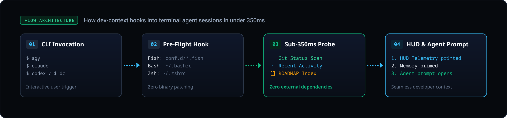

<div align="center">
  <a href="https://github.com/whysooraj/dev-context">
    
  </a>
</div>

<div align="center">
  <p><strong>Sub-second pre-flight context dashboard and task queue for terminal coding agents.</strong></p>
  <p>Eliminate blank-line paralysis before Antigravity, Claude Code, or Codex opens.</p>
</div>

---

## One-Line Install

Run the interactive multi-step installer:

```bash
curl -fsSL https://raw.githubusercontent.com/whysooraj/dev-context/main/install.sh | bash
```

The installer detects your local environment and guides you through 4 setup steps:

1. **Coding Agent Hooks**: Wraps detected agents (`agy`, `claude`, `codex`) or custom CLI commands.
2. **Shell Environment**: Writes clean, non-destructive hooks for Fish (`conf.d/dev_context_wrappers.fish`), Bash (`~/.bashrc`), or Zsh (`~/.zshrc`).
3. **Binary Location**: Installs standalone `dev-context` and short `dc` alias to `~/.local/bin/`.
4. **Focus Queue**: Scaffolds a starter `ROADMAP.md` in your projects directory.

---

## The Problem

When launching terminal AI coding agents, you are greeted by an empty prompt line:

```text
> What would you like to work on?
_
```

If you manage multiple open-source repositories or work solo across projects:

- You forget which repositories currently have uncommitted working trees or dirty branches.
- You lose track of which repo you were touching earlier in the day.
- Your backlog ideas remain scattered across tabs, issue trackers, and scratchpads.
- Context switching cost delays getting into deep flow.

`dev-context` resolves this in under 350ms before your agent cursor appears.

---

## How It Works

<div align="center">
  
</div>

1. **Trigger**: You invoke `agy`, `claude`, `codex`, or `dc` in your terminal.
2. **Pre-Flight Hook**: An interactive shell wrapper intercepts the command without patching or modifying agent binaries.
3. **Sub-350ms Probe**: A pure Python probe scans git status, uncommitted trees across your projects directory, recent commits, and your Markdown focus queue.
4. **HUD Telemetry**: Formatted ANSI telemetry is printed to the terminal.
5. **Agent Hand-off**: The coding agent loads immediately below the telemetry, giving you instant operational context.

---

## Telemetry Output Preview

```text
─── DEV FLIGHT CONTEXT ───
📍 my-api-service (main) [CLEAN]
   Last commit (20 minutes ago): feat: add rate limiting middleware

⚡ In-Progress / Uncommitted Work:
   • web-frontend (3 modified) — 45 minutes ago: fix: navigation layout
   • auth-service (2 modified) — 3 hours ago: test: add token verification tests

🕒 Recent Activity:
   • worker-pipeline        2 hours ago     -> chore: bump dependencies
   • docs-site              Yesterday       -> docs: update deployment guide

📋 Focus Queue (ROADMAP.md):
   ## Active Sprint
   [1] my-api-service: add redis cache layer
   [2] web-frontend: responsive mobile navbar
   ## Ideas Backlog
   [3] auth-service: webauthn passkey support
──────────────────────────
```

---

## Instant Task Management via `dc`

You never need to manually open or edit a Markdown file to track work:

```bash
# Print the full flight dashboard anytime
dc

# Add a high-priority task to the active sprint
dc add "my-api-service: add redis cache layer"

# Quick-add a backlog idea
dc idea "auth-service: webauthn passkey support"

# View open tasks with indexed IDs
dc list

# Mark task #2 complete (updates - [ ] to - [x])
dc done 2

# Delete task #3
dc rm 3

# Target current repository instead of global workspace
dc add -l "add dry-run unit test"
dc done -l 1
```

All commands update the human-readable `ROADMAP.md` while remaining 100% git-trackable.

---

## Workspace Discovery Logic

`dev-context` scans your workspace without external database services:

| Scan Target | Detection Method | Output Role |
| --- | --- | --- |
| Current Directory | `git status --porcelain` + `git branch` | Shows dirty files, active branch, and last commit |
| Workspace Repos | Scans `~/Projects/*/.git` (or `$DEV_CONTEXT_DIR`) | Surfaces repos with uncommitted work (`⚡`) |
| Recent Activity | `git log -1 --format=%ct|%cr|%s` | Shows top 4 recently modified projects |
| Focus Queue | Parses `- [ ] ` checklist items in `ROADMAP.md` | Indexes sprint priorities and backlog ideas |

### Roadmap File Resolution

The task manager searches for task lists in the following order:

1. Current repository `ROADMAP.md` or `TODO.md` (when inside a git repo)
2. Workspace root `~/Projects/ROADMAP.md`
3. Home directory `~/.roadmap.md`

---

## Shell Integration Reference

The installer configures interactive shell functions that pass all arguments and completions directly to the underlying binaries.

### Fish Shell (`~/.config/fish/conf.d/dev_context_wrappers.fish`)

```fish
function agy --wraps agy --description 'Run dev-context flight check then agy'
    if test -z "$DEV_CONTEXT_SKIP"; and status is-interactive
        dev-context
    end
    command agy $argv
end

function claude --wraps claude --description 'Run dev-context flight check then claude'
    if test -z "$DEV_CONTEXT_SKIP"; and status is-interactive
        dev-context
    end
    command claude $argv
end

function codex --wraps codex --description 'Run dev-context flight check then codex'
    if test -z "$DEV_CONTEXT_SKIP"; and status is-interactive
        dev-context
    end
    command codex $argv
end
```

### Bash / Zsh (`~/.bashrc` or `~/.zshrc`)

```bash
agy() {
  [ -z "$DEV_CONTEXT_SKIP" ] && [ -t 1 ] && dev-context
  command agy "$@"
}

claude() {
  [ -z "$DEV_CONTEXT_SKIP" ] && [ -t 1 ] && dev-context
  command claude "$@"
}

codex() {
  [ -z "$DEV_CONTEXT_SKIP" ] && [ -t 1 ] && dev-context
  command codex "$@"
}
```

---

## Manual Installation

To build and run from source:

```bash
git clone https://github.com/whysooraj/dev-context.git ~/Projects/dev-context
cd ~/Projects/dev-context
./install.sh
```

Or manually copy the script to your executable PATH:

```bash
cp bin/dev-context ~/.local/bin/dev-context
ln -sf ~/.local/bin/dev-context ~/.local/bin/dc
chmod +x ~/.local/bin/dev-context
```

---

## Environment Variables

| Variable | Default | Purpose |
| --- | --- | --- |
| `DEV_CONTEXT_DIR` | `~/Projects` | Base directory scanned for git repositories and roadmap |
| `DEV_CONTEXT_SKIP` | `0` | Set to `1` to bypass the pre-flight check for automation or subshells |

---

## License

MIT
